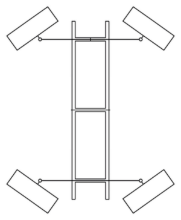
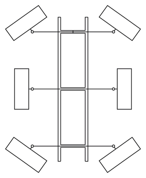
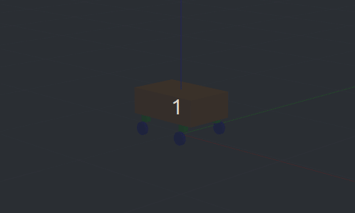

# Ackerman Drive Plugin (Swere Drive)

This package provides a Gazebo Classic plugin for a 4-wheel or 6-wheel Ackerman/Swerve drive robot. It is built for ROS2 Humble and Gazebo Classic. *(Note: If you plan to use modern Gazebo/Ignition in the future, you will need `ros_gz` dependencies. For Gazebo Classic, this uses `gazebo_ros_pkgs`.)*

When you run this plugin in your simulation, it subscribes to a `geometry_msgs/Twist` topic (like `cmd_vel`) to get the desired linear and angular speeds. It calculates the exact turning radii for each wheel using Ackerman steering geometry, which also supports crab steering (moving sideways) if your `cmd_vel` has movement on the Y-axis. The plugin then turns the 4 steering (stepper) joints to the correct angles using a Position PID controller, and spins the driving wheels at the correct speeds using a Velocity PID controller. Finally, it publishes `nav_msgs/Odometry` data to track the robot's position in the simulation world.

## Supported Drive Systems

This plugin currently supports two main drive configurations:
1. **Four-Wheel Complete Swerve:** All four wheels can steer independently and drive.
2. **Six-Wheel Drive:** Only the four corner wheels steer (swerve), while the other two middle wheels are rigid and only drive.

<div style="display: inline-block;">
  
  
</div>

## Prerequisites

Make sure you have the required ROS2 and Gazebo dependencies installed:

```bash
sudo apt update
sudo apt install ros-humble-gazebo-ros-pkgs ros-humble-gazebo-ros 
sudo apt install ros-humble-teleop-twist-keyboard
```

## How to Install and Build

**1. Create a Workspace:**
```bash
mkdir -p ~/sim_ws/src
cd ~/sim_ws/src
```

**2. Clone the Repository:**
```bash
git clone https://github.com/Karthikeya819/swere_drive.git
```

**3. Build the Package:**
```bash
cd ~/sim_ws
source /opt/ros/humble/setup.bash
colcon build --packages-select swere_drive
```

**4. Source the Workspace:**
```bash
source ~/sim_ws/install/setup.bash
```

## How to Launch

You can use the provided launch file to start the gazebo simulation. The launch file is parameterized so you can simply pass `six_wheel:=true` or `false`:

```bash
# For a Six-Wheel Robot
ros2 launch swere_drive robot_gazebo.launch.py six_wheel:=true

# For a Four-Wheel Robot
ros2 launch swere_drive robot_gazebo.launch.py six_wheel:=false
```

To drive the robot around, open a **new terminal**, source ROS2, and run the teleop node:
```bash
source /opt/ros/humble/setup.bash
ros2 run teleop_twist_keyboard teleop_twist_keyboard
```

## Plugin Configuration Examples

To use this plugin on your own robot, add the following blocks to your robot's SDF or URDF file. Make sure to replace the joint names with the actual names from your robot model.

### 1. Six Wheel Example

```xml
<gazebo>
  <plugin name="ackerman_drive_plugin" filename="libackerman_drive_plugin.so">
    <commandTopic>cmd_vel</commandTopic>
    <odometryTopic>odom</odometryTopic>
    <odometryFrame>odom</odometryFrame>
    <robotBaseFrame>base_link</robotBaseFrame>
    <updateRate>50</updateRate>
    <sixWheel>true</sixWheel>
    <wheelRadius>0.1</wheelRadius>
    <wheelSeperation>0.5</wheelSeperation>
    <wheelBase>0.6</wheelBase>
    <stepperP>1000.0</stepperP>
    <stepperI>0.0</stepperI>
    <stepperD>50.0</stepperD>
    <wheelP>0.5</wheelP>
    <wheelI>0.01</wheelI>
    <wheelD>0.02</wheelD>
    <front_left_stepper_joint>front_left_steer_joint</front_left_stepper_joint>
    <front_right_stepper_joint>front_right_steer_joint</front_right_stepper_joint>
    <back_left_stepper_joint>back_left_steer_joint</back_left_stepper_joint>
    <back_right_stepper_joint>back_right_steer_joint</back_right_stepper_joint>
    <front_left_wheel_joint>front_left_drive_joint</front_left_wheel_joint>
    <front_right_wheel_joint>front_right_drive_joint</front_right_wheel_joint>
    <middle_left_wheel_joint>middle_left_drive_joint</middle_left_wheel_joint>
    <middle_right_wheel_joint>middle_right_drive_joint</middle_right_wheel_joint>
    <back_left_wheel_joint>back_left_drive_joint</back_left_wheel_joint>
    <back_right_wheel_joint>back_right_drive_joint</back_right_wheel_joint>
  </plugin>
</gazebo>
```

### 2. Four Wheel Example

```xml
<gazebo>
  <plugin name="ackerman_drive_plugin" filename="libackerman_drive_plugin.so">
    <commandTopic>cmd_vel</commandTopic>
    <odometryTopic>odom</odometryTopic>
    <odometryFrame>odom</odometryFrame>
    <robotBaseFrame>base_link</robotBaseFrame>
    <updateRate>50</updateRate>
    <sixWheel>false</sixWheel>
    <wheelRadius>0.1</wheelRadius>
    <wheelSeperation>0.5</wheelSeperation>
    <wheelBase>0.6</wheelBase>
    <stepperP>1000.0</stepperP>
    <stepperI>0.0</stepperI>
    <stepperD>50.0</stepperD>
    <wheelP>0.5</wheelP>
    <wheelI>0.01</wheelI>
    <wheelD>0.02</wheelD>
    <front_left_stepper_joint>front_left_steer_joint</front_left_stepper_joint>
    <front_right_stepper_joint>front_right_steer_joint</front_right_stepper_joint>
    <back_left_stepper_joint>back_left_steer_joint</back_left_stepper_joint>
    <back_right_stepper_joint>back_right_steer_joint</back_right_stepper_joint>
    <front_left_wheel_joint>front_left_drive_joint</front_left_wheel_joint>
    <front_right_wheel_joint>front_right_drive_joint</front_right_wheel_joint>
    <back_left_wheel_joint>back_left_drive_joint</back_left_wheel_joint>
    <back_right_wheel_joint>back_right_drive_joint</back_right_wheel_joint>
  </plugin>
</gazebo>
```

## Demonstration



## Further Improvements

* **Reverse Kinematics:** Currently, the plugin uses Gazebo's exact `WorldPose()` to publish odometry. In the future, this can be updated to calculate real wheel-based odometry (Reverse Kinematics) for a more realistic simulation.
* **Velocity and Acceleration Limits:** Implement configurable maximum velocity, acceleration, and jerk limits within the plugin to simulate real-world hardware constraints and prevent sudden jumps.
